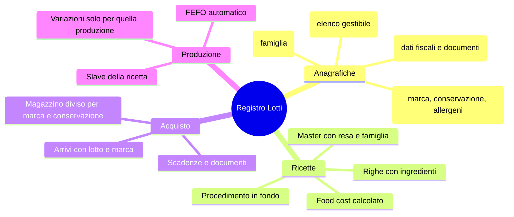
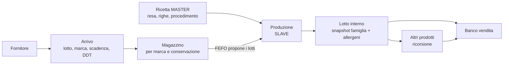

# Registro Lotti · Mappa del progetto

La visione d'insieme del software di gestione lotti per la ristorazione: come sono fatti i dati, come scorre la merce e quali regole di design teniamo ferme.

## 1. Le quattro anime del sistema

## 2. Il modello dei dati

Ogni scatola è una tabella del database; le frecce dicono chi punta a chi.

```mermaid
erDiagram
  FAMIGLIE ||--o{ PRODOTTI : "classifica (lavorati)"
  FORNITORI ||--o{ LOTTI_INGRESSO : "consegna"
  PRODOTTI ||--o{ LOTTI_INGRESSO : "arriva come"
  ALLERGENI ||--o{ PRODOTTI_ALLERGENI : "dichiarato da"
  PRODOTTI ||--o{ PRODOTTI_ALLERGENI : "dichiara (ingredienti)"
  PRODOTTI ||--o| RICETTE : "ha la sua master"
  RICETTE ||--o{ RICETTA_RIGHE : "compone"
  PRODOTTI ||--o{ RICETTA_RIGHE : "usato in"
  PRODOTTI ||--o{ LOTTI_INTERNI : "esce da"
  LOTTI_INGRESSO ||--o{ CONSUMI : "consumato da"
  LOTTI_INTERNI ||--o{ CONSUMI : "usa"
  PRODOTTI {
    string nome
    int famiglia_id
    string conservazione
    string marca
    string unita_misura
    string sigla
    string denominazione_legale
  }
  LOTTI_INGRESSO {
    string lotto_fornitore
    date arrivo
    date scadenza
    float quantita
    float residuo
    string marca
    float prezzo_unitario
    int iva
    string documenti
  }
  LOTTI_INTERNI {
    string lotto_interno
    date produzione
    date scadenza
    string famiglia_snapshot
    bool ricetta_variata
    float qta_prodotta
  }
  RICETTE {
    float resa
    string unita_misura
    string famiglia
    text procedimento
  }
  RICETTA_RIGHE {
    int ingrediente_id
    float quantita
  }
  CONSUMI {
    int lotto_origine
    float quantita_consumata
  }
```

Punti chiave del modello:

- **PRODOTTI copre due mondi**: gli ingredienti acquistati (famiglia NULL, con marca e conservazione) e i prodotti di laboratorio (con famiglia). Una sola tabella, due identità.
- **CONSUMI è la tabella della tracciabilità**: collega ogni lotto interno ai lotti che ha consumato, siano essi arrivi o altri lotti interni (per questo le creme finite tracciano fino alle uova della banca B).
- **RICETTE è master, LOTTI_INTERNI è slave**: la produzione fotografa (snapshot) la famiglia del giorno e registra se la ricetta è stata variata, senza mai toccare la ricetta salvata.

## 3. Il flusso operativo, dalla consegna al banco

Come leggere il flusso:

- Il **FEFO** propone i lotti che scadono prima: l'utente al massimo corregge.
- La produzione può **variare la ricetta e la famiglia solo per sé**: un lotto eccezionale non inquina lo standard.
- Gli **allergeni si ereditano lungo le frecce**: l'ingrediente li dichiara, ogni lotto interno li Somma dai suoi consumi. Nessuno li scrive a mano.
- L'**etichetta ingredienti si calcola dal verbale**: partendo dai consumi di un lotto interno e scendendo per ricorsione lungo i lotti interni consumati, con fusione per ingrediente d'origine (le uova della crema pasticcera + le uova dirette = UNA riga "uova" sommata), denominazioni legali e allergeni prodotti da un'unica funzione, righe in ordine decrescente di quantità (che però non si mostra: decide solo l'ordine, per legge decrescente di peso all'uso). La denominazione legale nasce in anagrafica ingrediente, la quantità effettivamente prodotta (`qta_prodotta`) sta sul lotto interno: nessuna tabella di snapshot.

## 4. Le regole di design che teniamo ferme

1. **I dati si chiedono dove nascono, non dove si usano**: la conservazione nasce in anagrafica ingrediente, la marca nasce nell'arrivo (con default), la famiglia nasce nella ricetta.
2. **Master e slave**: ricette e anagrafiche sono lo standard; produzioni e arrivi sono i fatti del giorno, con i loro snapshot.
3. **Eliminazioni protette**: si cancella solo ciò che non è referenziato (arrivi consumati, famiglie in uso, lotti in tracciabilità).
4. **Tutto si calcola dalle registrazioni**: giacenze, coperture, food cost, allergeni ed etichetta ingredienti non si digitano, derivano dai dati (i consumi sono il verbale della produzione).
5. **Un'u.m. per tipo**: g/kg e ml/lt si convertono da soli; teglie e vasetti non si traducono in kg (nessuna conversione implicita fra tipi diversi).

## 5. Cosa manca (v0.2 in poi)

- Shelf-life per prodotto: scadenza proposta automaticamente in produzione.
- Quantità riscalata in produzione (dose non base).
- "Può contenere tracce": contaminazione crociata, regole diverse dagli allergeni dichiarati.
- Utenti e login, quando servirà l'accesso condiviso.
- Backend vero: Python + SQLite (mono-utente), PostgreSQL oltre le 15-20 aziende.